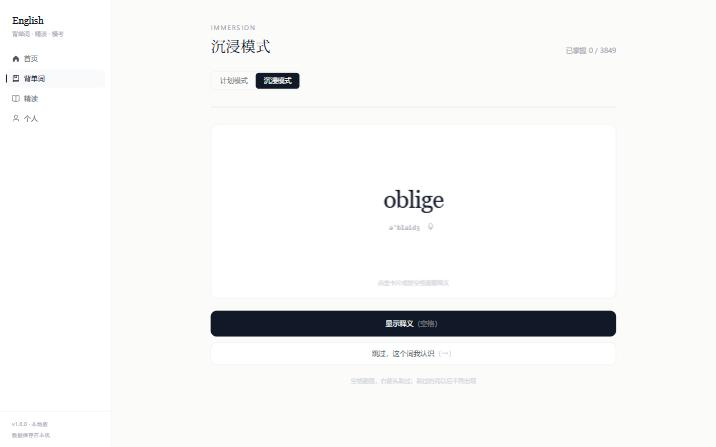
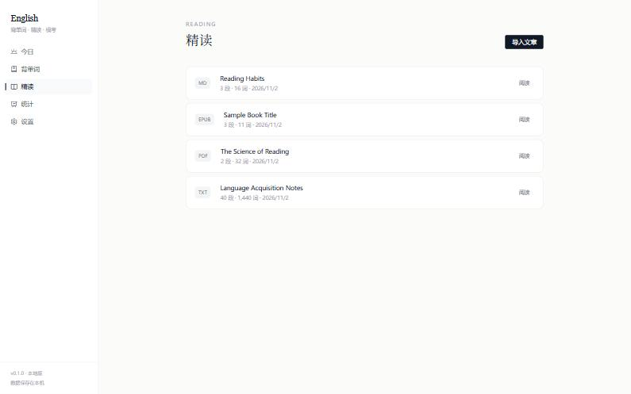
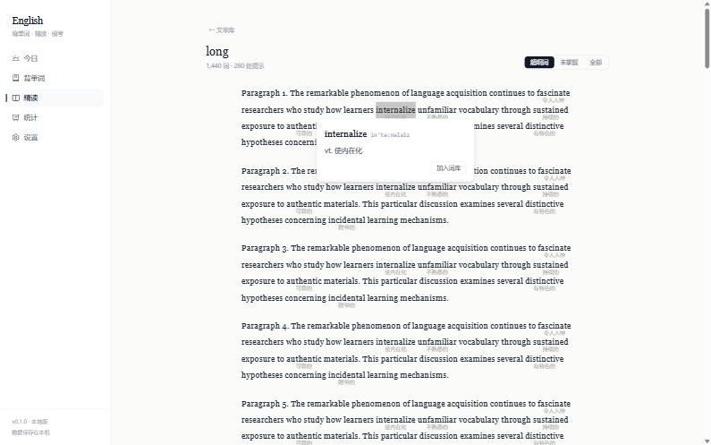

# English

跑在自己电脑上的英语学习站：**背单词 · 精读 · 学习统计**。

没有账号、没有服务器、不需要 API Key，词库和文章都在本地，断网也能用。


## 功能

| 模块 | 现在能做什么 |
|---|---|
| 背单词 · 计划模式 | 内置四六级 / 考研 / 雅思 / 托福 / GRE 词库，卡片翻转、发音，FSRS 间隔重复调度；每日新词量与每日复习上限各自可调 |
| 背单词 · 沉浸模式 | 不设配额，随机抽词：认识的直接跳过、从此不再出现，不认识的看完释义放回池子。进度按词库独立记录，全部掌握后可重新开始 |
| 精读 | 导入 txt / md / pdf / docx / epub 或直接粘网页链接；行间生词提示；划词查义；一键加入词库；阅读进度自动保存 |
| 个人 | 学习统计（复习量曲线、正确率、已学单词）与全部设置合在一页 |









## 快速开始

需要先装好 **Node.js 18+** 和 **Git**。Python 不用管，首次运行会自动装。

```powershell
git clone <你的仓库地址> english-app
cd english-app
npm install
npm link
english
```

`npm link` 把 `english` 注册成全局命令，之后在任意目录敲它都能启动。

首次运行会依次完成下面几步（约 3~10 分钟，取决于网速和机器）：

1. 安装 uv（Python 环境管理器）
2. 安装 Python 3.12
3. 安装后端依赖
4. 构建前端
5. 下载并导入 ECDICT 词库（约 77 万词条，耗时几分钟）

完成后浏览器会自动打开 `http://127.0.0.1:8765`。

## 日常使用

| 想做 | 怎么做 |
|---|---|
| 背今天的词 | 首页 → 开始今天的学习，空格翻面，1–4 评分 |
| 换词库 / 调每日新词量 | 首页选词库，设置页调每日新词量 |
| 导入文章 | 精读 → 导入文章 → 上传文件或粘贴链接 |
| 查词 | 阅读时选中任意单词，弹窗里可以加入词库 |
| 调注释密度 | 阅读页右上角切换：超纲词 / 未掌握 / 全部 |

## 开发

```powershell
npm run dev
```

同时起两个服务：Vite 在 `http://127.0.0.1:5173`（热更新），FastAPI 在 `http://127.0.0.1:8000`。Vite 把 `/api` 转发到后端，所以前端代码里永远写相对路径。

| 命令 | 作用 |
|---|---|
| `npm run dev` | 前后端一起起（开发用） |
| `npm run build` | 构建前端 + 编译启动器 |
| `npm run seed` | 重新导入词库 |
| `npm run typecheck` | 前端类型检查 |
| `uv --directory api run uvicorn app.main:app --reload` | 只起后端 |

接口文档在 `http://127.0.0.1:8000/docs`。

## 目录结构

```
english-app/
├── bin/english.ts     启动器：环境检查、引导、找端口、起服务、开浏览器
├── web/               Vue 3 + Vite + TypeScript + Tailwind + Element Plus
│   └── src/
│       ├── api/       接口封装
│       ├── components/ 卡片、图表、外壳
│       ├── views/     今日 / 背单词 / 精读 / 阅读 / 统计 / 设置
│       └── stores/    Pinia: study / stats / settings
├── api/               FastAPI + SQLAlchemy + Alembic
│   └── app/
│       ├── models/    数据模型
│       ├── routers/   接口
│       ├── services/  FSRS 调度、查词、生词注释
│       └── parsers/   pdf / epub / docx / txt / 网页
└── scripts/           ECDICT 导入
```

## 数据存在哪

Windows 上在 `%APPDATA%\english-app\`：

- `data/english.db` —— 词库、学习记录、文章
- `data/ecdict.csv` —— 原始词库文件
- `uploads/` —— 上传的文章原件
- `logs/api.log` —— 后端日志

**不在仓库目录里**，所以 `git pull` 或重新构建都不会弄丢学习记录。

想完全重置：关掉应用，删掉 `%APPDATA%\english-app\` 整个目录，再运行 `english`。

## 常见问题

**启动后浏览器白屏** —— 后端还没起来，等几秒刷新。仍不行就看 `%APPDATA%\english-app\logs\api.log`。

**提示端口被占用** —— 启动器会自动尝试 8765 之后的 20 个端口。如果一直失败，多半是上次的 python 进程没退干净，任务管理器里结束 python 即可。

**词库下载失败** —— 自动下载可能被网络拦截，手动下载 [ecdict.csv](https://github.com/skywind3000/ECDICT) 放到 `%APPDATA%\english-app\data\`，再运行 `npm run seed`。下载支持断点续传，中断后重跑会接着下。

**PDF 导入后没有内容** —— 扫描版 PDF 没有文本层，抽不出正文。目前会明确提示，后续版本再考虑 OCR。

**查不到某个词** —— 词库来自 ECDICT，专有名词、新造词、变形特别生僻的可能查不到。

**Word 文档打不开** —— 只支持 `.docx`。老式的 `.doc` 请先另存为 `.docx`。

**PowerShell 不让执行脚本** —— 用 `powershell -ExecutionPolicy Bypass -File .\xxx.ps1`。

**提示「database disk image is malformed」** —— 数据库文件损坏了。关掉应用，删掉 `%APPDATA%\english-app\data\english.db`（连同同目录下的 `english.db-wal`、`english.db-shm`），再运行 `npm run seed` 重新导入词库即可，词库三分钟就能重建。学习记录会丢，词库不会。

**同时开了两个服务进程** —— 别这么做。启动器自己会找空闲端口，但两个进程写同一个数据库容易出问题。

## 版本

**v1.0.0** — 三个模块的完整形态：

- [x] 项目骨架、启动器、数据模型、Alembic 迁移
- [x] ECDICT 词库导入与内置词库过滤
- [x] 背单词：计划模式（FSRS 调度、新词与复习配额）、沉浸模式（随机抽词、按词库记录进度）
- [x] 精读：多格式解析、生词注释、划词查义、加入词库
- [x] 个人页：学习统计与设置
- [x] 异常处理、移动端可用、生产构建与单进程托管
- [ ] 情景模式、做题模块（后续版本）

## 技术选择说明

- **一个进程、一个端口**：FastAPI 同时托管 API 和前端构建产物，启动器不用管两个进程。
- **数据不放仓库**：放在 `%APPDATA%`，`git pull` 不会误删学习记录。
- **两套背诵互不干扰**：计划模式走 FSRS 复习队列，沉浸模式用独立的随机抽词算法，数据分别存在 `user_word` 和 `immersion_word`。
- **沉浸模式按词库记账**：同一个词在 CET4 跳过，不算 CET6 已掌握——两个词库重合约九成，按词记账会让重置一个库清掉另一个库的进度。
- **所有解析器输出同一种结构**：新增格式不用改前端。
- **不做全文翻译**：左右对照时人会直接读中文、跳过英文，对语言学习是负作用。
- **不渲染 PDF 原版面**：目标是把内容变成可选择的文本，不是复刻排版。
